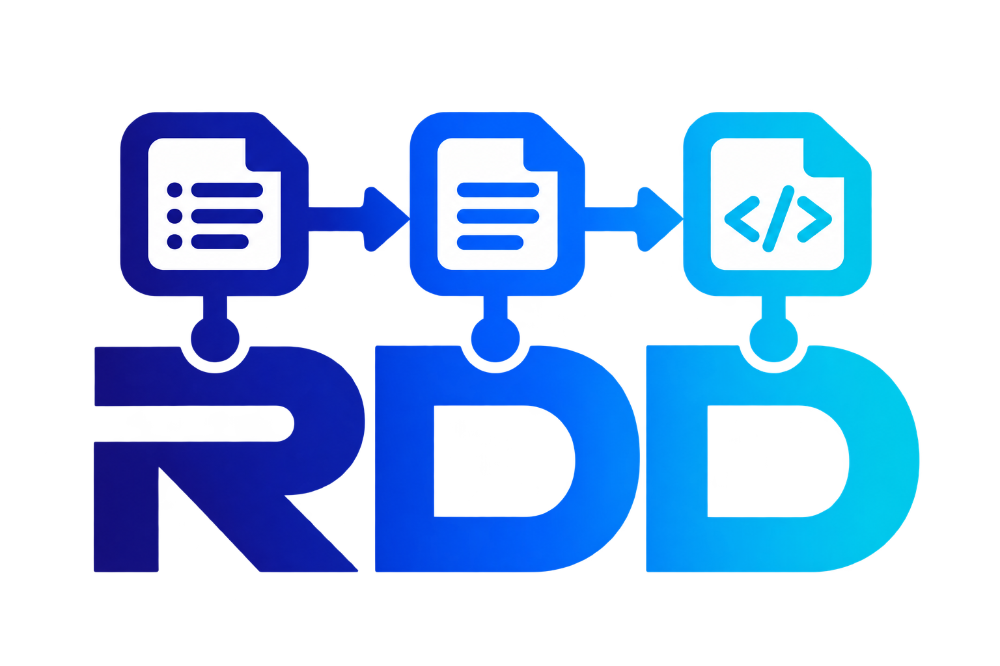

<p align="center">
  
</p>

[](README.md)
[](README.pt-br.md)

# RDD — RDD Workflow (Open Core)

**RDD (Requirements, Documentation, Development)** is an open-core, context
engineering workflow for [OpenCode](https://opencode.ai): requirements
orchestration, technical documentation and AI-assisted development — from
business demand to traceable technical artifacts that feed issues and pull
requests.

Maintained by the RDD maintainers. License **Apache-2.0** + contribution via
**DCO**.

## How it works

RDD applies a phased specification methodology to take a business requirement
all the way to a traceable technical artifact:

1. **Intake** — captures the project charter, legacy context and asks
   structured questions to reduce ambiguity before formal requirements are
   generated.
2. **Requirements** — consolidates business rules (RNs), use cases, fields and
   decisions into a versioned `REQUIREMENTS.md`, with stable IDs and traceable
   pending items (PEND-XXX).
3. **Technical Translation** — from the RNs, generates up to 7 parallel
   artifacts: data model, API contracts, UI spec, architecture, glossaries,
   user stories and acceptance criteria.
4. **Quality & Delivery** — test strategy, traceability matrix, DAG integrity
   validation, task specification.

Every phase is optional — modules may skip artifacts that don't apply to
their context.

## Components

- **Primary agents (RDD Quadri)** — the active persona of your OpenCode
  session (switch with Tab):
  - `rdd-req` — Requirements: business discovery, greenfield intake, meetings and requirements management.
  - `rdd-doc` — Documentation: technical documentation of existing systems, multi-repo reverse engineering and specs.
  - `rdd-dev` — Development: code implementation in your repositories from approved tasks.
  - `rdd-devops` — DevOps: deployment infrastructure (VPS, Docker, registry, SSH, Cloudflare tunnels) and guided troubleshooting.
- **Subagents (25):** phase orchestrators (`rdd-intake-orchestrator`,
  `rdd-requirements-orchestrator`, `rdd-translation-orchestrator`,
  `rdd-quality-orchestrator`, `rdd-support-orchestrator`,
  `rdd-governance-orchestrator`), reverse engineering
  (`rdd-reverse-orchestrator`), code specialists (`rdd-dev-backend`,
  `rdd-dev-frontend`), independent QA (`rdd-dev-qa`), pre-PR review
  (`rdd-dev-reviewer`) and utilities (GitHub, Azure, Figma,
  workflow builder/improver, next, progress).
- **Skills (78):** on-demand knowledge blocks (prefixed `rdd-`), executable
  standalone or composed into larger flows.

## Getting Started

Prerequisites: [OpenCode](https://opencode.ai) installed; `git`; `gh` CLI
(optional — only to create your pack's remote repo).

```bash
# 1. Clone the core into OpenCode's global config directory
git clone https://github.com/victor-souza-dev/RDD-CORE.git ~/.config/opencode
```

2. Open OpenCode in your projects directory and pick a primary with **Tab**
   (start with `rdd-req`).
3. Run the **`rdd-setup`** skill — first-configuration wizard: projects
   directory, your organization's profile (`rules/client-profile.md`, local
   and gitignored) and environment validation. Tracker/infrastructure fields
   can stay generic if you don't use them yet.
4. Create your organization's pack with **`rdd-pack-scaffold`** — complete
   skeleton (`pack.yaml` + org rule + accumulation), private repo on your
   GitHub and runtime installation. **Your** company's specific content lives
   here — never in the core.
5. Start working:
   - New product → `rdd-project-intake` on `rdd-req`;
   - Existing system → `rdd-doc` with your repositories;
   - Code from tasks → `rdd-dev`.
6. Core updates: `git pull` on your clone (generated files are gitignored —
   your runtime never gets dirty).

> **Note:** `rdd-setup` asks tracker (Azure) and infrastructure defaults — if
> you don't use them, fill with generic values or skip; the workflow works
> without them.

## Open core architecture — your two private repos + the public engine

You will maintain **two private repositories**, and connect to a third (the
public one):

- **Your private CORE** (anywhere — GitHub, GitLab, Azure DevOps, local):
  your working instance of the engine. Workflow improvements you make HERE
  can go UP to the public CORE (fork + PR — the contribution bridge below).
- **Your private PACK** (created by `rdd-pack-scaffold`): your organization's
  content — patterns, accumulated lessons, org rules. Lives wherever you
  want. Content here STAYS here (only generic patterns get promoted to the
  public hub).
- **The public CORE** (this repo): the generic engine everyone shares —
  releases flow DOWN to your instance (`git pull`); generic improvements flow
  UP from your private instance (via PR).

### What lives where — and what goes upstream

| Content | Lives in | Goes upstream? |
|---|---|---|
| Workflow engine — generic (agents, skills, generic knowledge) | Your private CORE → **public CORE** | ✅ yes — via fork + PR |
| Workflow engine — your org's tweaks | Your private CORE only | ❌ no (org-specific) |
| Organization patterns & accumulated lessons | Your private PACK | ❌ no (generic patterns → public hub) |
| Client profile & settings | Local files (gitignored) | ❌ never |
| Client/product knowledge | Local/profile only | ❌ never |

### "I improved the engine in my private CORE — how does it reach everyone?"

Your private instance doesn't need to be on GitHub — the bridge is a fork
plus a second remote:

```bash
# in your private instance (Azure DevOps, GitLab, local):
git remote add fork https://github.com/<you>/RDD-CORE.git
git push fork my-improvement
# then open the PR against upstream main (the CI of evals gates the merge)
```

- **Generic improvement** (new skill, better prompts, script fix, generic
  knowledge) → PR upstream → lands in the public CORE for everyone.
- **Org-specific tweak** (how YOUR org works) → stays in your private
  instance/PACK — never upstream.
- **Client-specific content or knowledge** → local/profile only — never any
  repo.

### Three layers with content precedence PROFILE > PACK > CORE

```
CORE (public — this repo, Apache-2.0 + DCO)
 │   agents/, skills/, rules/ (templates), registry.yaml
 │
PACK (private to YOUR organization)
 │   pack.yaml → provides/  → installable core content (via copy)
 │              accumulation/ → patterns/metrics/reverses — never installed
 │
PROFILE (local, gitignored — rules/client-profile.md)
     declares packs: [<id>@<range>]
```

Runtime (`~/.config/opencode/`):

```
core clone
 ├── packs/<id>/          pack clones (gitignored)
 ├── rules/packs/<id>.md  organization rule (installed from the pack)
 ├── .rdd/sources.yaml    lockfile: pack → installed version + commit
 └── core + installed files (provides copy)
```

**Golden rule (neutrality gate):** only generalized, anonymized content enters
the core, via PR — client-specific knowledge stays in your pack. The gate
(`evals/neutrality/scan.sh`) runs on CI, on pre-push and before every release.

## Registry and artifacts

`registry.yaml` is the workflow's **canonical manifest** — every component,
relation and domain. The structural views of `ARCHITECTURE.md` are generated
from it by the `rdd-registry-render` skill — never edit those sections
manually. The registry's `version` field is the manifest schema; content is
versioned by git.

Documentation in this repo: `PACK_SCHEMA.md` (pack contract), `MIGRATION.md`
(migration from the old approach to the open core), `BREAKING-CHANGES.md`,
`CONTRIBUTING.md` (DCO + anonymization checklist), `PUBLISH.md` (release
process).

## Releases

**Snapshot** model: maintainers develop in a private repository and publish
**clean copies of the essential subset** to this repo (`publish-core.sh` +
process in `PUBLISH.md`) — the public repo contains no internal history.
Improvement history and design decisions live in the development repository.

- **Adopter:** update with `git pull` on your clone.
- **Contributor:** PR to this repo, with **DCO** (`git commit -s`) and
  neutrality gate approval — full guide in `CONTRIBUTING.md`.

## Conventions

- `rdd-` prefix on every platform skill and subagent.
- Stable IDs: RN-XXX (business rules), PEND-XXX (clarification pending items).
  IDs are immutable — an RN never gets renumbered.
- Structural names (paths, contract fields) in English; content and
  documentation in PT-BR.
- Repo lifecycle convention: `rdd-<repo>-<action>` — `rdd-core-update`/
  `rdd-core-publish` (core) and `rdd-pack-update`/`rdd-pack-publish` (packs).
- Project-specific rules live in the product (`<repo>/.opencode/rules/`),
  not in the core.
- Document DAG: PROJECT_CHARTER → REQUIREMENTS → translation artifacts →
  quality.

## License

[Apache-2.0](LICENSE) — contributions under [DCO 1.1](https://developercertificate.org/).
